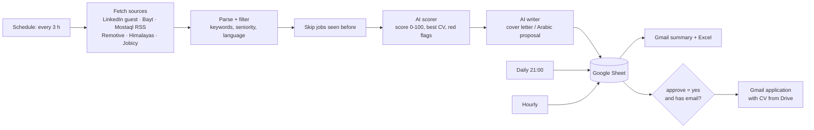

# n8n Job Hunter

An [n8n](https://n8n.io) workflow that searches for remote jobs several times a day, has an AI score each one against my profile, writes a tailored cover letter, saves everything to Google Sheets, and emails me a daily summary. Jobs that accept email applications can be sent from Gmail with the right CV attached after I approve them in the sheet.

## Highlights

- **34 nodes**, three schedules (collect, daily digest, apply) sharing one settings node.
- **Two AI roles**: a fast scorer (Gemini Flash-Lite, free tier) for every job and a writer (Gemini Flash, or Claude / ChatGPT if a key is set) only for the good ones, to keep cost near zero.
- **De-duplication** across runs, keyword include/exclude rules, and a cap on AI calls per run.
- **Human in the loop**: nothing is sent until I write `yes` in the sheet's `approve` column (or set an auto-apply score threshold).
- Code nodes live in `src/` as plain JavaScript and are assembled by `build.js`, so the logic is readable and versioned.

## Files

| Path | What it is |
|:---|:---|
| `workflow/job-hunter.json` | Import this into n8n |
| `workflow/jobs-sheet-template.xlsx` | Upload to Google Drive → *Save as Google Sheets* |
| `src/config.js` | The only node you edit: sheet URL, AI keys, keywords, CV file IDs, profile |
| `src/*.js` | Code nodes: sources, parsing, scoring, writing, digest, apply selection |
| `build.js` | Rebuilds the workflow JSON from `src/` (`node build.js`) |

## Setup

1. Run n8n (cloud, or `docker run -it --rm -p 5678:5678 -e GENERIC_TIMEZONE=Africa/Cairo docker.n8n.io/n8nio/n8n`).
2. *Create workflow → ⋯ → Import from file* → `workflow/job-hunter.json`.
3. Open **⚙️ الإعدادات** (settings) and fill `sheetUrl`, `keys.gemini` (free at aistudio.google.com), `cvDriveIds`, `myEmail`.
4. Connect your Google account on the Sheets, Gmail and Drive nodes.
5. Click **Execute workflow** once to test, then activate it.

> Built and tested on n8n 2.x. LinkedIn is read from its public guest pages only; no login, no scraping of private data.

## Author

**Zyad Mohamed Abdelfattah** — QA tester at Findo Group, Surveying & GIS graduate.
[Portfolio](https://zyad-mohamed-abdelfattah.vercel.app) · [LinkedIn](https://www.linkedin.com/in/zyad-mohamed-abdelfattah-37b9223bb)

MIT License
